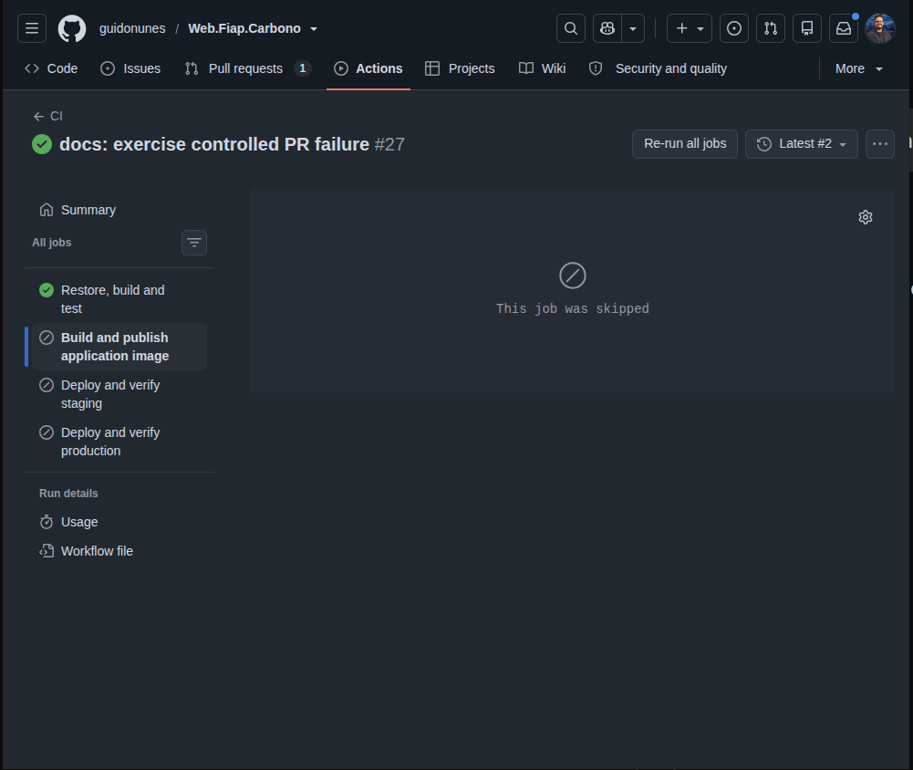
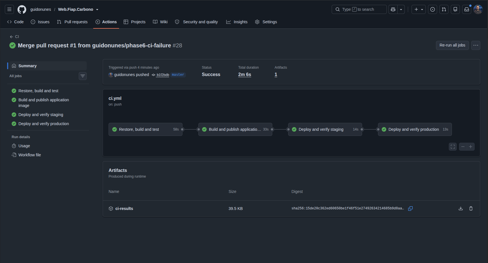
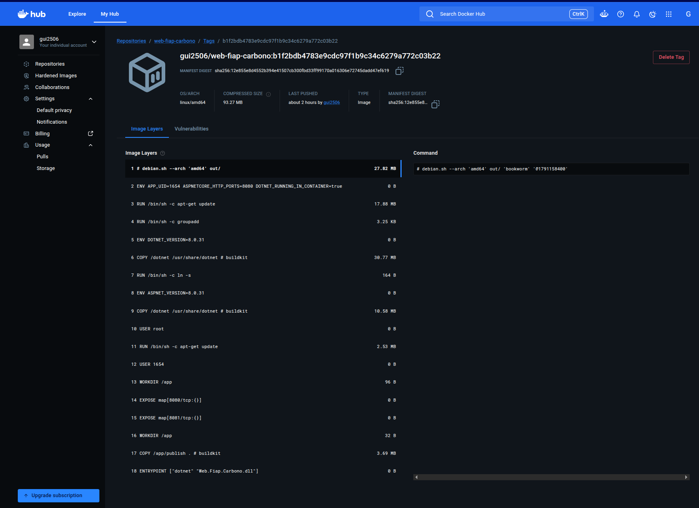
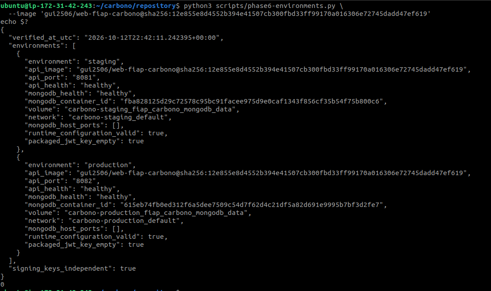
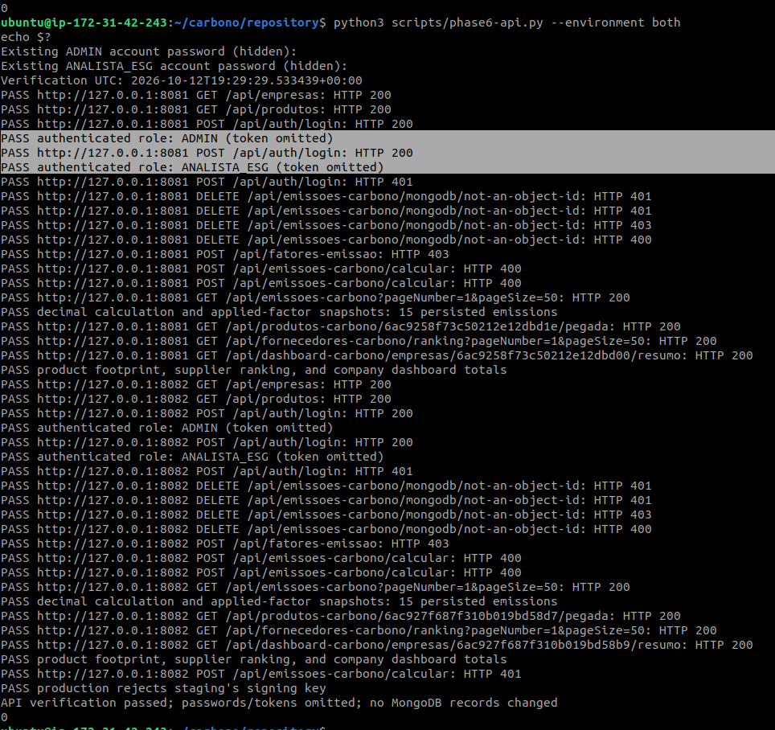
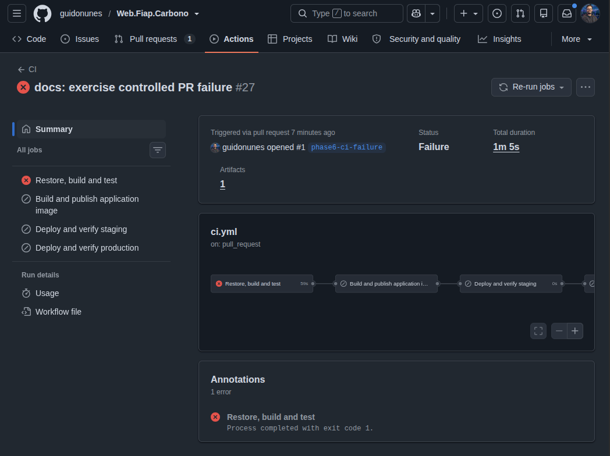
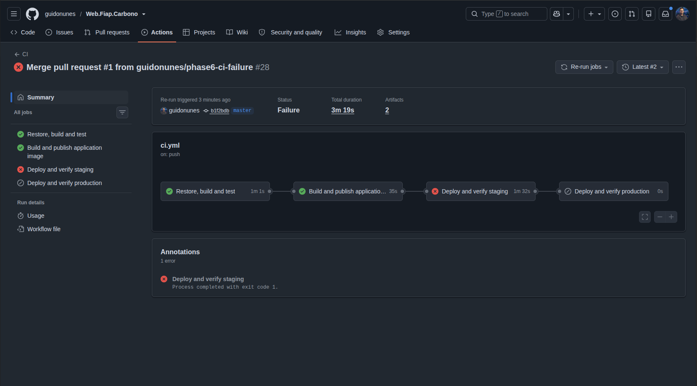
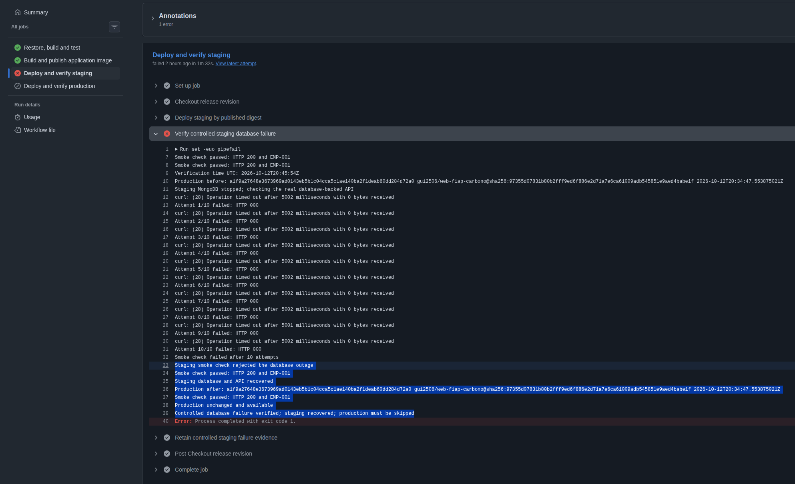
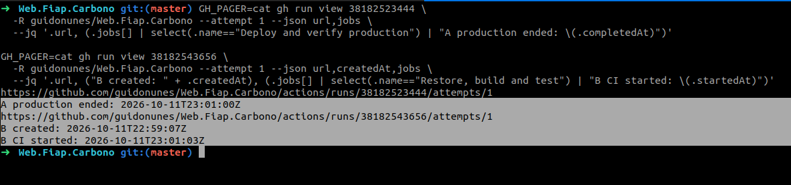

# Projeto - Cidades ESGInteligentes

**Web.Fiap.Carbono** é uma API REST acadêmica da FIAP para medir e analisar emissões de gases de efeito estufa em cadeias de suprimentos. A persistência ativa usa MongoDB e o projeto mantém exatamente cinco coleções ESG. O pipeline no GitHub Actions testa a solução, publica a imagem no Docker Hub e promove o mesmo digest por staging e produção em uma instância Ubuntu na AWS EC2.

- [Como executar localmente com Docker](#como-executar-localmente-com-docker)
- [Pipeline CI/CD](#pipeline-cicd)
- [Containerização](#containerização)
- [Prints do funcionamento](#prints-do-funcionamento)
- [Tecnologias utilizadas](#tecnologias-utilizadas)

## Funcionalidades

- Autenticação JWT com os papéis ADMIN e ANALISTA_ESG.
- CRUD de empresas, produtos, fornecedores e fatores de emissão.
- Cálculo decimal de emissões em kgCO2e.
- Pegada de produto, ranking de fornecedores e dashboard empresarial por agregações MongoDB.
- Validação de referências, fatores, ObjectIds, paginação e índices únicos.
- Testes de integração contra MongoDB descartável.
- Swagger/OpenAPI no ambiente Development.

Fórmula: quantidadeEmitidaKgCO2e = quantidadeAtividade × fatorAplicado.valor. A unidade da atividade deve ser compatível com a unidade-base do fator.

## Tecnologias utilizadas

| Área | Tecnologia |
|---|---|
| Runtime e API | .NET 8, C# e ASP.NET Core |
| Persistência | MongoDB 8 com MongoDB.Driver |
| Autenticação | JWT Bearer |
| Documentação | Swagger/OpenAPI com Swashbuckle |
| Testes | xUnit, WebApplicationFactory e Testcontainers |
| Containerização | Docker Engine, Dockerfile com múltiplas etapas e Docker Compose |
| CI/CD | GitHub Actions, executores Ubuntu do GitHub e executor próprio na EC2 |
| Registro de imagens | Docker Hub, tags com o SHA completo e deploy por digest SHA-256 |
| Hospedagem | Ubuntu na AWS EC2, região `us-east-2` (Ohio) |
| Verificação operacional | Bash, curl, jq e Python 3 |

## Arquitetura

~~~mermaid
flowchart LR
    Cliente[Cliente HTTP] --> Controllers[Controllers]
    Controllers --> Services[Serviços MongoDB]
    Services --> Repositories[Repositórios MongoDB]
    Repositories --> Mongo[(MongoDB)]
    Services --> Rules[Validações e cálculo decimal]
    Controllers --> Swagger[Swagger/OpenAPI]
~~~

O código ativo está organizado em Controllers, Services/MongoDb, Data/MongoDb, Models/Documents, Dtos/MongoDb, Config/MongoDb e Middlewares. A ferramenta Web.Fiap.Carbono.Migration é separada da API e o código Oracle histórico está em archive/oracle.

A API está em `src/Web.Fiap.Carbono/` e a ferramenta de migração em `src/Web.Fiap.Carbono.Migration/`. O projeto `Web.Fiap.Carbono.Tests/`, a solução, o `Dockerfile`, `database/` e `archive/` permanecem na raiz. Execute os comandos deste README a partir da raiz do repositório.

## Modelo MongoDB

O banco padrão é fiap_carbono e contém exatamente:

| Coleção | Responsabilidade |
|---|---|
| empresas | Identidade, metas ESG e governança |
| produtos | Produtos, empresa proprietária e atributos ambientais flexíveis |
| fornecedores | Dados ambientais, sociais, certificações e auditorias |
| fatores_emissao | Fatores versionados, unidades, fontes, escopos e validade |
| emissoes_carbono | Eventos auditáveis e contexto do cálculo |

Produtos referenciam empresas por empresaId. Emissões referenciam empresa, produto, fornecedor e fator por ObjectId. Em cada emissão, lote, etapa, dadosAtividade e fatorAplicado são snapshots embutidos. Lotes e etapas não são coleções.

A flexibilidade de dadosAtividade representa diferenças reais entre TRANSPORTE, ENERGIA, MATERIA_PRIMA e RESIDUO.

## Configuração

Para executar a API diretamente com o SDK, use `src/Web.Fiap.Carbono/appsettings.Development.json`, que não é versionado, ou variáveis de ambiente:

| Variável | Exemplo |
|---|---|
| MongoDb__ConnectionString | mongodb://localhost:27017 |
| MongoDb__DatabaseName | fiap_carbono |
| Jwt__SecretKey | chave local com pelo menos 32 caracteres |
| Jwt__Issuer | Web.Fiap.Carbono |
| Jwt__Audience | Web.Fiap.Carbono.Users |
| Jwt__ExpirationMinutes | 60 |

Não coloque credenciais, tokens ou strings de conexão reais no Git.

No Docker Compose, prepare o arquivo `.env` conforme a seção abaixo. A conexão da API está definida no `docker-compose.yml` como `mongodb://mongodb:27017`, com banco `fiap_carbono`. Os valores `MongoDb__ConnectionString` e `MongoDb__DatabaseName` do `.env.example` documentam esses valores, mas atualmente não os substituem no Compose. `localhost` dentro do container da API não aponta para o MongoDB.

## Como executar localmente com Docker

Pré-requisitos: Docker Engine em execução, plugin Docker Compose com suporte a `--wait` e `--wait-timeout`, acesso aos registros de imagens e `curl` no host. O comando de geração de chave abaixo usa OpenSSL; a verificação com `scripts/smoke.sh` também exige Bash e `jq`. Não é necessário instalar .NET SDK ou `mongosh` no host para executar via Compose. Execute os comandos na raiz do repositório, onde estão `Dockerfile`, `docker-compose.yml` e `.env.example`.

### Preparar a configuração

Na raiz do repositório, crie `.env` somente se ele ainda não existir:

~~~bash
export APP_IMAGE=web-fiap-carbono:local
if [ ! -f .env ]; then cp .env.example .env; fi
chmod 600 .env
openssl rand -hex 32
~~~

Copie a chave gerada para `Jwt__SecretKey` no `.env`; esse campo está vazio no exemplo, e o Compose rejeita a configuração enquanto ele não for preenchido. Se você já tem uma chave local configurada, mantenha-a. Mantenha a chave privada; não inclua sua saída em prints. O `.env` é ignorado pelo Git e excluído do contexto da imagem.

Configure também `API_PORT` (padrão `8081`), `Jwt__Issuer`, `Jwt__Audience` e `Jwt__ExpirationMinutes` (padrão `60`). O `.env` fornece esses valores ao Compose; ele não é carregado automaticamente por `dotnet run`.

### Iniciar API e banco

~~~bash
docker compose -p carbono-local --env-file .env config --quiet
APP_IMAGE=web-fiap-carbono:local docker compose \
  -p carbono-local --env-file .env \
  up -d --build --wait --wait-timeout 120
docker compose -p carbono-local --env-file .env ps
~~~

Espere os serviços `api` e `mongodb` ficarem `healthy`. O limite de 120 segundos se aplica à espera de disponibilidade, não à duração do build. Use `config --quiet` para validar sem imprimir a configuração resolvida, que contém a chave JWT.

O valor explícito de `APP_IMAGE` no comando de build seleciona a imagem local, mesmo se o terminal tiver uma variável de uma verificação anterior. Os deploys automatizados usam uma imagem publicada por digest e não executam esse build local.

Com `API_PORT=8081`, verifique:

~~~bash
curl --noproxy '*' --fail --silent --show-error --include --max-time 5 \
  http://127.0.0.1:8081/api/empresas

bash scripts/smoke.sh http://127.0.0.1:8081/api/empresas
~~~

O resultado esperado é HTTP `200` e um único array JSON contendo uma empresa com `codigo` igual a `EMP-001`. O script deve imprimir `Smoke check passed: HTTP 200 and EMP-001` e terminar com código `0`. O health check interno exige as mesmas condições; corpo vazio, múltiplos documentos JSON, erro HTTP ou ausência dessa empresa falham. Ajuste a URL se escolher outra porta.

A API escuta HTTP na porta interna `8080`. O Compose atual usa o ambiente ASP.NET Core padrão `Production`, sem Swagger; não use `/swagger` para verificar disponibilidade. Esse nome de ambiente não significa que houve deploy de produção. MongoDB não publica a porta `27017` no host. Para inspecioná-lo, use:

~~~bash
docker compose -p carbono-local --env-file .env exec mongodb mongosh fiap_carbono
~~~

### Inicialização e dados persistentes

Em um volume novo, o MongoDB executa automaticamente, nesta ordem:

1. `01-create-collections.js`: cria as cinco coleções e validadores.
2. `02-create-indexes.js`: cria índices únicos e de consulta.
3. `03-seed.js`: insere o conjunto coerente de demonstração com pelo menos dez documentos por coleção.

Os scripts `04-crud-demo.js` e `05-aggregation-queries.js` permanecem em `database/mongodb/` para execução manual deliberada. Eles não fazem parte da inicialização. O primeiro demonstra CRUD com registros `CRUD-TEMP`; o segundo consulta agregações.

Os dados ficam no volume `carbono-local_fiap_carbono_mongodb_data`, montado em `/data/db`. Com arquivos de banco existentes, a inicialização é ignorada, mesmo se as coleções estiverem vazias. Não execute novamente o seed para reiniciar: seus upserts substituem documentos e podem sobrescrever alterações. Não use `down -v` nem remova o volume para uma reinicialização normal.

Se a primeira inicialização falhar, preserve o volume e examine os logs antes de escolher uma recuperação. Um volume parcialmente inicializado pode ser ignorado na próxima partida; reiniciar não garante completar o seed. A presença de `EMP-001` também não comprova todos os índices e dados. Não há reset automático do banco.

### Reiniciar, atualizar e parar

Para reiniciar os containers com a configuração existente e aguardar disponibilidade:

~~~bash
docker compose -p carbono-local --env-file .env restart
docker compose -p carbono-local --env-file .env up -d --wait --wait-timeout 120
~~~

Depois de alterar código, Dockerfile, Compose ou `.env`, use o comando abaixo para reconstruir a imagem e aplicar a configuração. `restart` sozinho não aplica novas variáveis de ambiente.

~~~bash
APP_IMAGE=web-fiap-carbono:local docker compose \
  -p carbono-local --env-file .env \
  up -d --build --wait --wait-timeout 120
~~~

Para recriar os containers deliberadamente, preservando o volume:

~~~bash
docker compose -p carbono-local --env-file .env up -d --force-recreate --wait --wait-timeout 120
~~~

Para parar e depois retomar o mesmo ambiente:

~~~bash
docker compose -p carbono-local --env-file .env stop
docker compose -p carbono-local --env-file .env up -d --wait --wait-timeout 120
~~~

Mantenha o mesmo nome de projeto (`-p`) em todos os comandos: ele identifica a rede, os containers e o volume desse ambiente. Trocar o nome cria recursos separados. Se a porta estiver ocupada, escolha outra em `.env` e ajuste a URL de verificação.

Para investigar uma falha, consulte `ps` e os logs; não remova o volume:

~~~bash
docker compose -p carbono-local --env-file .env ps -a
docker compose -p carbono-local --env-file .env logs --no-color --tail 100 api mongodb
~~~

Repita a consulta a `/api/empresas` após a retomada. Revise os logs antes de compartilhar evidências para evitar exposição de dados ou credenciais.

## Execução com o SDK

Como alternativa ao Compose completo, instale .NET 8 SDK e disponibilize uma instância MongoDB separada, acessível pelo host e previamente inicializada com os scripts `01`, `02` e `03` em um banco novo. Configure MongoDB e JWT em `appsettings.Development.json` ou no ambiente. O MongoDB do Compose acima não fica acessível em `localhost:27017`.

Compile e execute:

~~~bash
dotnet restore Web.Fiap.Carbono.sln
dotnet build Web.Fiap.Carbono.sln
dotnet run --project src/Web.Fiap.Carbono/Web.Fiap.Carbono.csproj --launch-profile http
~~~

A API fica em http://localhost:5269 e o Swagger em http://localhost:5269/swagger no ambiente Development.

## Endpoints

Todas as rotas usam o prefixo /api.

| Método | Rota | Autorização | Finalidade |
|---|---|---|---|
| POST | /api/auth/login | Pública | Emitir JWT |
| GET | /api/emissoes-carbono?pageNumber=1&pageSize=10 | Pública | Listar emissões |
| GET | /api/emissoes-carbono/{idEmissao} | Pública | Consultar emissão por legacyId |
| GET | /api/emissoes-carbono/mongodb/{id} | Pública | Consultar por ObjectId |
| POST | /api/emissoes-carbono/calcular | ADMIN ou ANALISTA_ESG | Calcular emissão |
| PUT, DELETE | /api/emissoes-carbono/mongodb/{id} | ADMIN/ANALISTA_ESG e ADMIN | CRUD temporário de emissão |

CRUD completo está disponível em /api/empresas, /api/produtos, /api/fornecedores e /api/fatores-emissao, com rotas POST, GET, PUT e DELETE. Criação e atualização exigem ADMIN ou ANALISTA_ESG, exceto fatores, que exigem ADMIN; exclusão exige ADMIN.

Analytics:

- GET /api/produtos-carbono/{id}/pegada: total e totais por etapa.
- GET /api/fornecedores-carbono/ranking?pageNumber=1&pageSize=10: ranking paginado.
- GET /api/dashboard-carbono/empresas/{id}/resumo: totais, meses, produtos, fornecedores e escopos.

Paginação começa em 1 e aceita pageSize entre 1 e 50.

## Testes

~~~bash
dotnet test Web.Fiap.Carbono.sln
~~~

Os testes usam a aplicação real e MongoDB 8 descartável em container, com banco isolado. Cobrem CRUD, índices únicos, ObjectIds inválidos, referências ausentes, fatores inativos/expirados, cálculo decimal, snapshots, quatro variantes de atividade, agregações, paginação, autenticação, autorização, erros e Swagger.

A configuração JWT dos testes usa valores sintéticos definidos na factory; não é necessário fornecer `appsettings.Development.json` nem iniciar o MongoDB do Compose. A fixture de API usa rede do host Linux e porta `27019`: evite execuções simultâneas. Se houver timeout, verifique a disponibilidade do Docker, o acesso à porta e a conectividade com VPN ativa.

Para executar os testes em Release e guardar o relatório TRX:

~~~bash
dotnet restore Web.Fiap.Carbono.sln
dotnet build Web.Fiap.Carbono.sln --configuration Release --no-restore
dotnet test Web.Fiap.Carbono.sln --configuration Release --no-build \
  --logger "trx;LogFileName=local.trx" \
  --results-directory ./artifacts/test-results/local
~~~

## Containerização

O [Dockerfile](Dockerfile) na raiz usa múltiplas etapas: restaura, compila e publica somente a API com o SDK .NET 8, depois copia a publicação para a imagem ASP.NET Core 8. A imagem final contém `curl` e `jq` para o health check e executa a API com o usuário definido por `APP_UID`. A ferramenta de migração e as dependências Oracle permanecem separadas; Oracle não é necessário para iniciar a API.

### Conteúdo do Dockerfile

~~~dockerfile
FROM mcr.microsoft.com/dotnet/aspnet:8.0 AS base
USER root

RUN apt-get update \
    && apt-get install -y --no-install-recommends curl jq \
    && rm -rf /var/lib/apt/lists/*

USER $APP_UID
WORKDIR /app
EXPOSE 8080
EXPOSE 8081

FROM mcr.microsoft.com/dotnet/sdk:8.0 AS build
ARG BUILD_CONFIGURATION=Release
WORKDIR /src
COPY ["src/Web.Fiap.Carbono/Web.Fiap.Carbono.csproj", "src/Web.Fiap.Carbono/"]
RUN dotnet restore "src/Web.Fiap.Carbono/Web.Fiap.Carbono.csproj"
COPY . .
WORKDIR "/src/src/Web.Fiap.Carbono"
RUN dotnet build "./Web.Fiap.Carbono.csproj" -c $BUILD_CONFIGURATION -o /app/build

FROM build AS publish
ARG BUILD_CONFIGURATION=Release
RUN dotnet publish "./Web.Fiap.Carbono.csproj" -c $BUILD_CONFIGURATION -o /app/publish /p:UseAppHost=false

FROM base AS final
WORKDIR /app
COPY --from=publish /app/publish .
ENTRYPOINT ["dotnet", "Web.Fiap.Carbono.dll"]
~~~

### Estratégias adotadas

- **Separação entre compilação e execução:** o SDK fica nas etapas de build/publicação; a imagem final usa o runtime ASP.NET Core e recebe os arquivos publicados da API.
- **Cache de dependências:** o `.csproj` é copiado e restaurado antes do restante do código, permitindo reutilizar essa camada quando as dependências não mudam.
- **Execução sem root:** após instalar curl e jq, a imagem usa o usuário `APP_UID` para executar a API.
- **Instalação enxuta:** `--no-install-recommends` evita pacotes opcionais e a lista do apt é removida na mesma camada.
- **Configuração em tempo de execução:** MongoDB e JWT são configurados pelo Compose, sem incluir a chave de assinatura no Dockerfile.
- **Dados persistentes:** o MongoDB grava em um volume próprio; recriar a imagem ou o container da API preserva os dados do banco.

As instruções `EXPOSE` descrevem portas da imagem, mas não publicam portas no host. O Compose configura a API para escutar em `8080` e publica essa porta como `8081` em staging ou `8082` em produção.

Para apenas construir a imagem local:

~~~bash
docker build --file Dockerfile --tag web-fiap-carbono:local .
~~~

O [docker-compose.yml](docker-compose.yml) executa essa API e `mongo:8.0.29-noble` na rede padrão do projeto, com volume persistente próprio. A API aguarda o health check do MongoDB e verifica dados pelo endpoint `/api/empresas`. O Compose seleciona `APP_IMAGE`, usando `web-fiap-carbono:local` como padrão; `API_PORT` controla a porta do host. A porta da API dentro do container é `8080`, e MongoDB não publica sua porta no host.

Staging e produção usam a mesma definição Compose, com nomes de projeto distintos. Cada API acessa apenas o MongoDB do seu ambiente. A imagem da API é compartilhada, enquanto configurações, chaves JWT, redes e volumes são independentes.

~~~mermaid
flowchart LR
    subgraph EC2[Ubuntu na AWS EC2]
        subgraph Staging[Projeto carbono-staging]
            SAPI[API - porta 8081] --> SMONGO[(MongoDB)]
            SMONGO --> SVOL[Volume de staging]
        end
        subgraph Producao[Projeto carbono-production]
            PAPI[API - porta 8082] --> PMONGO[(MongoDB)]
            PMONGO --> PVOL[Volume de produção]
        end
    end
~~~

A imagem pública está em [gui2506/web-fiap-carbono no Docker Hub](https://hub.docker.com/r/gui2506/web-fiap-carbono). Cada publicação recebe o SHA completo do commit como tag; o digest identifica o conteúdo utilizado nos deploys. Na verificação de **12 de outubro de 2026**, a tag `b1f2bdb4783e9cdc97f1b9c34c6279a772c03b22` resolveu para `sha256:12e855e8d4552b394e41507cb300fbd33ff99170a016306e72745dadd47ef619`, e os dois ambientes usaram essa referência. Esse é um resultado datado, não uma afirmação sobre a imagem de commits posteriores.

Para consultar essa versão no registro, sem iniciar containers:

~~~bash
docker buildx imagetools inspect \
  gui2506/web-fiap-carbono:b1f2bdb4783e9cdc97f1b9c34c6279a772c03b22
~~~

A `.dockerignore` exclui arquivos reais de ambiente, configurações de desenvolvimento, saídas de compilação e ZIPs do contexto. O `appsettings.json` versionado mantém `Jwt.SecretKey` vazio; o valor é recebido em tempo de execução. As verificações registradas conferiram os arquivos da API e a ausência dos arquivos de migração/ambiente/desenvolvimento esperados em `/app`; isso não equivale a uma auditoria de todo o histórico de camadas da imagem.

## Pipeline CI/CD

O workflow está em [.github/workflows/ci.yml](.github/workflows/ci.yml). Pull requests executam restauração, compilação e testes. Um push em `master`, após CI bem-sucedida, publica a imagem e realiza os deploys de staging e produção nessa ordem.

~~~mermaid
flowchart LR
    PR[Pull request] --> CI[Restaurar, compilar e testar]
    MASTER[Push em master] --> CI
    CI -->|Somente push em master aprovado| IMAGE[Construir e publicar no Docker Hub]
    IMAGE --> STAGING[Deploy de staging por digest]
    STAGING --> SCHECK[Saúde e smoke check de staging]
    SCHECK --> PROD[Deploy de produção pelo mesmo digest]
    PROD --> PCHECK[Saúde e smoke check de produção]
~~~

| Job | Executor | Condição e resultado |
| --- | --- | --- |
| `ci` | Ubuntu 24.04 do GitHub | Restaura, compila em Release e executa os testes em PRs e pushes em `master` |
| `image` | Ubuntu 24.04 do GitHub | Após CI aprovada em push para `master`, constrói a API, publica `${DOCKERHUB_USERNAME}/web-fiap-carbono:${GITHUB_SHA}` e fornece o digest |
| `deploy_staging` | Executor próprio na EC2 | Recebe o digest publicado, usa o checkout do commit da execução e valida staging |
| `deploy_production` | Mesmo executor na EC2 | Exige publicação e staging aprovados e valida produção usando o mesmo digest |

Em PRs, `image`, `deploy_staging` e `deploy_production` ficam como **Skipped**. Uma falha de CI impede a publicação; uma falha de staging impede o deploy de produção. O artefato `ci-results` guarda o resumo das etapas e os relatórios TRX gerados por quatorze dias em execuções não canceladas, inclusive quando há falha.

Os testes usam configurações JWT sintéticas e MongoDB descartável; não se conectam aos bancos de staging ou produção. O executor próprio, registrado como `carbono-ec2`, atende às etiquetas `self-hosted`, `linux`, `x64` e `carbono-deploy`. Ele executa o Compose localmente na EC2; SSH é usado para administração manual.

### Configuração dos ambientes e credenciais

| Configuração | Staging | Produção |
| --- | --- | --- |
| Projeto Compose | `carbono-staging` | `carbono-production` |
| API no host | `8081` | `8082` |
| URL de verificação dentro da EC2 | `http://127.0.0.1:8081/api/empresas` | `http://127.0.0.1:8082/api/empresas` |
| Arquivo de ambiente | `/home/ubuntu/carbono/staging/staging.env` | `/home/ubuntu/carbono/production/production.env` |
| Volume MongoDB | `carbono-staging_fiap_carbono_mongodb_data` | `carbono-production_fiap_carbono_mongodb_data` |
| Rede | `carbono-staging_default` | `carbono-production_default` |

No GitHub, configure `DOCKERHUB_USERNAME` e `DOCKERHUB_TOKEN` em **Settings → Secrets and variables → Actions → Secrets**. O usuário de publicação deve corresponder ao repositório de aplicação usado pelos jobs: `gui2506/web-fiap-carbono`. O token precisa permitir a publicação nesse repositório.

Os arquivos de ambiente da EC2 ficam fora dos checkouts, com permissão `600`, proprietário `ubuntu` e chaves JWT diferentes. Cada arquivo fornece sua própria `API_PORT` e configuração JWT. A conexão MongoDB e o nome do banco são definidos no Compose conforme a seção de configuração. O executor precisa de acesso ao Docker e dos comandos Bash, curl e jq. O deploy local não usa chave SSH nem credenciais AWS no workflow.

As variáveis `PHASE6_VERIFY_CI_FAILURE` e `PHASE6_VERIFY_STAGING_FAILURE` permitem testar o bloqueio do pipeline por falhas controladas de CI e de MongoDB em staging. Para execução normal, mantenha ambas ausentes ou com o valor `false`.

### Disponibilidade, falhas e concorrência

O [scripts/deploy.sh](scripts/deploy.sh) recebe projeto, arquivo de ambiente, referência completa por digest e URL do ambiente. Ele valida a configuração, baixa a imagem da API, executa `up --no-build --wait` com limite de 120 segundos e chama [scripts/smoke.sh](scripts/smoke.sh). O script de smoke tenta até dez vezes, exige HTTP `200`, um único array JSON e a empresa `EMP-001`. Uma falha retorna código diferente de zero e bloqueia o job dependente.

O grupo de concorrência `carbono-release-${{ github.ref }}`, com `cancel-in-progress: false`, serializa todo o fluxo de releases de `master`. Uma nova execução não cancela a que já está rodando. Execuções pendentes podem ser substituídas por uma mais recente; não há garantia de deploy para cada commit enfileirado.

Para verificar um ambiente já iniciado, execute **na EC2**, a partir da raiz do checkout:

~~~bash
bash scripts/smoke.sh http://127.0.0.1:8081/api/empresas
bash scripts/smoke.sh http://127.0.0.1:8082/api/empresas

docker inspect --type container \
  --format '{{.Name}}: {{.Config.Image}}' \
  carbono-staging-api-1 carbono-production-api-1

python3 scripts/phase6-environments.py
~~~

Os smoke checks devem terminar com código `0`. O relatório de ambientes deve mostrar os quatro containers saudáveis, a mesma imagem nas APIs e recursos/configurações isolados, sem imprimir chaves ou valores secretos. Python 3 é necessário somente para esse relatório e os outros verificadores Python.

O [registro de deploy e recuperação](docs/ci-cd-deployment.md) contém o procedimento manual completo com commit e digest conhecidos. Antes de uma recuperação manual, aguarde os workflows terminarem e suspenda o executor ocioso para evitar sobreposição. Use um checkout correspondente à versão escolhida, recupere staging antes de produção, valide os dois ambientes e depois retome o executor. Preserve os volumes e não reaplique o seed. Esse procedimento usa uma referência histórica própria; não misture seu digest com os resultados posteriores abaixo.

## Prints do funcionamento

Os nove prints abaixo documentam execuções reais da API, do pipeline e dos ambientes. As legendas identificam o resultado observado e os links apontam para as execuções ou os relatórios correspondentes. Os horários citados são das execuções em UTC, não necessariamente do momento da captura da imagem.

### CI aprovada em pull request

Na [tentativa 2 da execução 38302777058](https://github.com/guidonunes/Web.Fiap.Carbono/actions/runs/38302777058/attempts/2), em 12/10/2026, a CI do PR #1 passou e os jobs de entrega ficaram **Skipped**. O [resumo](docs/images/ci-cd/pr-recovery-summary.txt) e o [TRX preservado](docs/images/ci-cd/pr-recovery-ci.trx) confirmam 107 testes aprovados, zero falhas e nenhum teste não executado. O SHA do diagnóstico `744e332c996e07749ea4a18da64f76aa0ab57401` é registrado separadamente do head do PR `70743919e4a209ddf5e46c12d3d8fcf53e5cdcdb`.

### Pipeline completo em master

A [tentativa original da execução 38304927773](https://github.com/guidonunes/Web.Fiap.Carbono/actions/runs/38304927773/attempts/1), commit `b1f2bdb4783e9cdc97f1b9c34c6279a772c03b22`, mostra a sequência aprovada em 12/10/2026. Esse print pertence ao sucesso original; as tentativas de falha e recuperação têm registros separados.

### Imagem versionada no Docker Hub

A tag `b1f2bdb4783e9cdc97f1b9c34c6279a772c03b22` de `gui2506/web-fiap-carbono` aponta para `sha256:12e855e8d4552b394e41507cb300fbd33ff99170a016306e72745dadd47ef619`, plataforma `linux/amd64`. A captura concorda com a consulta ao registro apresentada pelo usuário e com o relatório de ambientes abaixo; não atribui retroativamente esse digest à publicação da tentativa original.

### Staging e produção saudáveis e isolados

O relatório executado pelo usuário na EC2 em **12/10/2026 às 22:42:11 UTC**, com a referência esperada em `--image`, terminou com código `0`. Os quatro containers estavam saudáveis, as APIs usavam o digest `12e855e8...` acima, as portas eram `8081`/`8082` e os volumes, redes e chaves eram independentes. MongoDB não tinha portas publicadas. O print comprova o estado observado nessa data, sem afirmar que todo commit posterior usa a mesma imagem.

### Autenticação, cálculo e consultas analíticas

Em **12/10/2026 às 19:29:29 UTC**, `phase6-api.py --environment both` terminou com código `0`: validou logins ADMIN/ANALISTA_ESG, respostas `401`/`403`/`400`, cálculo decimal de quinze emissões persistidas por ambiente e totais de pegada, ranking e dashboard. Produção rejeitou o JWT de staging. Nenhum registro foi alterado e senhas/tokens foram omitidos; esse exercício não criou uma nova emissão calculada.

### Falha de CI impede a entrega

A [tentativa 1 da execução 38302777058](https://github.com/guidonunes/Web.Fiap.Carbono/actions/runs/38302777058/attempts/1), em 12/10/2026, passou restauração e compilação, falhou no teste controlado e reteve os diagnósticos. Publicação e ambos os deploys ficaram **Skipped**. O print mostra os estados dos jobs; não apresenta o conteúdo do relatório de falha nem seus contadores.

### Falha de staging bloqueia produção

Na [tentativa 2 da execução 38304927773](https://github.com/guidonunes/Web.Fiap.Carbono/actions/runs/38304927773/attempts/2), CI, publicação e deploy normal de staging passaram. O exercício de indisponibilidade do banco falhou deliberadamente com código `1`, e o job de produção ficou **Skipped**. A [tentativa 3](https://github.com/guidonunes/Web.Fiap.Carbono/actions/runs/38304927773/attempts/3) recuperou os deploys usando os resultados anteriores de CI/publicação; ela não realizou uma nova publicação.

### Recuperação do banco de staging e produção preservada

O exercício começou em **12/10/2026 às 20:45:54 UTC**: MongoDB de staging foi parado, o smoke check rejeitou a indisponibilidade e o mesmo container de banco foi restaurado. Produção preservou o ID `a1f9a276...`, o digest anterior `97355d...` e a hora de início, além de passar no smoke check. O [log original preservado](docs/images/ci-cd/staging-failure.txt) confirma a comparação e a recuperação antes da falha intencional. A disponibilidade foi verificada antes e depois; não houve medição contínua. O digest de produção durante a falha é diferente do digest do deploy recuperado.

### Releases sem sobreposição

Em 11/10/2026, a execução A ([38182523444](https://github.com/guidonunes/Web.Fiap.Carbono/actions/runs/38182523444)) terminou produção às **23:01:00 UTC**. B ([38182543656](https://github.com/guidonunes/Web.Fiap.Carbono/actions/runs/38182543656)) foi criada enquanto A rodava, mas iniciou CI às **23:01:03 UTC**. A captura concorda com os metadados inspecionados e comprova a serialização desse par.

A persistência também foi verificada pelo usuário em 12/10/2026: um produto temporário permaneceu idêntico após recriar API/MongoDB de staging, com o mesmo volume, e não apareceu em produção. A limpeza removeu exatamente um registro. Os [comandos e resultados originais](docs/ci-cd-deployment.md#storage-preservation-verification--october-12-2026-utc) complementam o print de isolamento; não existe um print histórico separado desse teste.

## Erros e documentação complementar

Os códigos principais são 400 para validação, 401 para autenticação, 403 para autorização, 404 para ausências, 409 para conflitos, 422 para fator inválido e 500 para falhas inesperadas.

- [Decisão técnica da migração](docs/mongodb-migration.md)
- [Baseline Oracle da reconciliação](docs/oracle-baseline.md)
- [Relatório de reconciliação](docs/oracle-mongodb-reconciliation.md)
- [Ferramenta de migração legada](src/Web.Fiap.Carbono.Migration/README.md)
- [Deploy e recuperação](docs/ci-cd-deployment.md)
- [Guia de verificação CI/CD](docs/ci-cd-verification.md)
